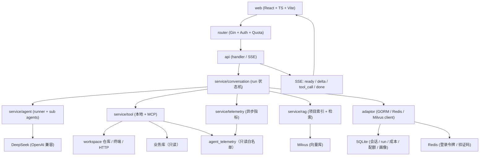

# Code Analyse Agent

面向代码仓库的 AI 分析应用：输入一个 Git 仓库地址或本机项目路径，系统会把它克隆/挂载到工作区、建立项目级语义索引，然后用一个会调用工具的多 Agent 链路，产出结构化的代码分析报告、项目问答与运行自省报表。界面中的产品名为 Repo Agent。

后端 Go（Eino + Gin），前端 React 18 + TypeScript + Vite。内置 SSE 流式输出、断连续传、审批中断恢复、崩溃续跑、账号鉴权、成本/配额统计与运行指标埋点；前端提供 Markdown/Mermaid 渲染、项目分析导出与四套可切换的界面外观。

## 功能特性

| 能力 | 说明 |
| ---- | ---- |
| 仓库分析 | 给出 Git URL 或本机路径，自动 fetch 到工作区并输出固定 8 节的 Markdown 报告（含 Mermaid 图）。 |
| 项目问答 | 针对“当前项目”连续追问，例如某接口在哪实现、配置怎么加载、调用链怎么串。 |
| 自省报表 | 基于 `agent_telemetry.run_metrics` 做只读查询，产出运行表现的中文 Markdown 自省报表；需开启 `self_report.enable` 且用户在 `self_report.allowed_users` 白名单中。 |
| 项目级 RAG | 按项目隔离 Milvus collection，符号级切分 + 中文查询改写 + RRF 融合 + 重排，语义检索项目代码。 |
| 结构化索引 | 项目级符号表 + 依赖/类型关系图，独立 SQLite、与 RAG 解耦；支持按符号名、文件依赖、继承/实现精确查询，覆盖 16 种语言。 |
| 工具调用 | 本机终端命令、HTTP 请求、项目扫描/搜索、文件读取、Git 仓库拉取、RAG 检索、结构化索引查询、运行指标查询，以及 MCP 外部工具。 |
| 流式对话 | SSE 逐事件下发（`ready`/`delta`/`reason`/`tool_call`/`tool_result`/`done`/`error` 等），前端 Markdown + Mermaid 渲染。 |
| 断连续传 | run 与 HTTP 请求解绑，客户端断线/刷新后按 `Last-Event-ID` 回放并继续跟随。 |
| 审批中断恢复 | 高危终端命令需人工审批，审批后从 checkpoint 复用同一条 run 继续执行。 |
| 崩溃续跑 | 进程重启时把遗留 `running` run 标记为 `interrupted`，前端可回放已落库内容。 |
| 降级收尾 | 子 Agent 达到最大迭代轮次时注入收尾指令并清空工具列表，基于已有证据直接作答；run 标记 `degraded`，原因记为 `max_iterations` / `error_partial`。 |
| 账号与配额 | 用户名或邮箱 + 密码登录（Redis 不透明令牌）+ 邮箱验证码注册 + 邮箱验证码重设密码，按用户区分配额与成本。 |
| 用户画像 | 登录后强引导填写（用户类型/技能水平/目标类型/当前主题/当前阶段/描述），`PUT /api/profile` 保存即入库、`GET /api/profile` 登录后回读，随每轮对话注入模型；每次实际变更会保留一条历史快照。 |
| 会话管理 | 会话列表、轻量详情、删除、只读分享链接，以及按消息懒加载的调用链路。 |
| 报告导出 | 仅项目分析回答可导出 Markdown 或 PDF；PDF 通过浏览器打印，保留渲染后的 Mermaid 图。 |
| 外观系统 | 顶栏「外观」可切换经典手册 / 深空控制台 / 纸本社论 / 蓝图工坊四套布局，浅色 / 深色 / 跟随系统独立切换；`?ui=<id>&theme=light\|dark` 可直接预览。 |
| 运行指标 | 每轮 run 结束后聚合迭代轮次、工具调用/失败、token、成本、压缩次数等指标，异步写入 `agent_telemetry`；只包含数字与 ID，不包含问题、回答或工具入参。 |
| 限流与熔断 | 入口 Redis 令牌桶（登录按 user_id、登录前公开接口按 IP，多实例共享额度）；主模型 / embedding / rerank / 查询改写四条出站链路挂熔断，连续失败后快速失败、半开自动试探。 |
| 可观测 | OpenTelemetry tracing（OTLP / stdout 回退），结构化日志。 |

## 架构总览

请求从 Gin 路由进入，经鉴权与配额中间件后落到 `api` 层；`service` 层负责编排业务，把事件写入 run 状态机、广播给在线订阅者，并按需调用各类 Agent 与工具；`adaptor` 层封装 SQLite、Redis、Milvus 与成本/会话/审批等仓储。



## 目录结构

```text
.
├── main.go                 # 进程入口：加载配置、初始化 tracing、起 HTTP 与 MCP 服务
├── agent_code_local.yml    # 本地配置（含密钥，已被 .gitignore 忽略）
├── api/                    # HTTP handler：chat / session / auth / profile / cost / quota / rag / sse
├── router/                 # 路由注册 + 鉴权、配额、tracing 中间件
├── service/
│   ├── agent/              # runner 与子 Agent：repo_analyzer / project_qa / self_report
│   │                       # 以及 userprofile、compress、skill、force_answer 等中间件
│   ├── codeindex/          # 项目级结构化索引：符号表 + 依赖/类型关系图（独立 SQLite）
│   ├── conversation/       # 对话编排、run 状态机、断连续传、审批恢复、运行指标投递
│   ├── rag/                # 全局与项目级索引、切分、查询改写、RRF 融合
│   ├── tool/               # terminal / http_request / project_scan / project_search / read_files
│   │                       # repo_fetch / rag / self_report / MCP 工具
│   ├── auth/               # 账号密码、邮箱验证码、令牌签发/校验
│   ├── cost/  quota/       # 成本与配额统计
│   ├── telemetry/          # run 聚合指标异步写入 agent_telemetry
│   ├── projectid/          # 项目 ID 派生（remote 优先，镜像地址先归一化）
│   └── dto/ do/ consts/    # 传输对象、领域对象、常量
├── adaptor/                # adaptor.go + repo/（GORM 仓储）+ vector/（Milvus/rerank）
├── mcpserver/              # 对内暴露配额与成本的 MCP Server
├── common/ utils/ config/  # 公共常量、日志、追踪、邮件、计价、路径与配置加载；
│                           # utils/limiter（Redis 令牌桶）、utils/circuitbreaker（熔断器）
├── web/                    # React + TypeScript + Vite 前端；设计文档见 DESIGN.md / APPEARANCE.md / PRODUCT.md
├── docs/                   # 上下文压缩设计与评测说明
├── e2e/  eval/             # 端到端测试与评测脚本
├── jaeger/  milvus/        # 本地可观测与向量库的 docker-compose
├── scripts/                # 本地 embedding / rerank 启动脚本（PowerShell）
└── .github/workflows/      # CI：构建后端与前端并发布 Release
```

## 快速开始

### 环境要求

- Go `1.26.5`（见 `go.mod`）
- Node.js `20+`（前端构建）
- C 编译器 / CGO（SQLite 驱动 `gorm.io/driver/sqlite` 依赖 cgo）
- Redis（登录令牌与邮箱验证码存储，启动时会 Ping，连不上直接退出）
- Milvus `2.6.x`（仅在 `rag.enabled: true` 时需要）
- 可用的对话模型与 embedding / rerank 服务

### 1. 准备配置

本地配置写在项目根目录的 `agent_code_local.yml`，该文件含真实密钥、已被 `.gitignore` 忽略，不会进仓库。最小可运行配置：

```yaml
server:
  app_name: "edu.agent.code"
  http_addr: ":8088"
  log_level: debug

sqlite:
  path: data/edu.agent.code.db

deepseek:
  base_url: "https://api.deepseek.com"
  model: deepseek-flash
  api_key: "<你的 key>"

redis:
  addr: "<host>:6379"
  username: ""
  password: ""
  db: 0

auth:
  token_ttl_hours: 168
  accounts:
    - { username: "admin", password: "<密码>", plan: "pro" }
  # 邮箱验证码注册：enabled 为 true 且 SMTP 配置有效时才开放。
  # 密码重设只需 SMTP 配置有效，不依赖注册开关。
  register:
    enabled: true
    plan: "free"                 # free / plus / pro
    code_ttl_minutes: 10
    resend_interval_seconds: 60
    max_attempts: 5
  smtp:
    enabled: true
    host: "smtp.example.com"
    port: 465                    # 465(ssl) / 587(starttls)
    username: "noreply@example.com"
    password: ""                 # 不要写真实授权码；由环境变量 SMTP_PASSWORD 注入
    from: "noreply@example.com"
    from_name: "代码仓库分析工作台"
    tls: "ssl"                   # ssl / starttls / none（none 仅本地测试）
    timeout_seconds: 10

workspace:
  root: "<绝对路径>/workspace"
  repos_dir: "<绝对路径>/workspace/repos"

rag:
  enabled: true
  docs_root: "<绝对路径>/docs/test_doc"
  embedding:
    base_url: "https://open.bigmodel.cn/api/paas/v4"
    model: embedding-3
    api_key: "<你的 key>"
    dimensions: 2048
  milvus:
    address: "<host>:19530"
    collection: edu_agent_code_docs
  rerank:
    enabled: true
    base_url: "https://open.bigmodel.cn/api/paas/v4/rerank"
    model: rerank
    api_key: "<你的 key>"
```

把 `rag.enabled` 设为 `false` 可关闭 Milvus 与语义索引，此时不会创建 Milvus 客户端。`redis` 段是必需的：启动时会 Ping，地址为空或连接失败都会直接退出；`auth` 不配置时没有可登录的账号。

未配置 `model_price.price_cny` 时对话仍可运行，但该模型的调用成本会按 0 记录并输出告警；需要成本统计时请补齐对应模型单价，`cache_hit` 必须显式配置为正数。

SMTP 密码等敏感项支持环境变量覆盖，启动时在读取 YAML 后应用：`SMTP_ENABLED`、`SMTP_HOST`、`SMTP_PORT`、`SMTP_USERNAME`、`SMTP_PASSWORD`、`SMTP_FROM`、`SMTP_FROM_NAME`、`SMTP_TLS`、`SMTP_TIMEOUT_SECONDS`、`AUTH_REGISTER_ENABLED`。推荐的部署方式是在 systemd / 容器环境里只注入 `SMTP_PASSWORD`，配置文件中的 `auth.smtp.password` 永远留空。

```bash
# 例：QQ 邮箱 SMTP 授权码（不是邮箱登录密码）
export SMTP_PASSWORD="<从密钥管理系统注入>"
```

Milvus 不是启动的硬依赖：`rag.enabled: true` 但 Milvus 连不上时，服务会以**降级模式**启动（HTTP 照常监听、其余功能不受影响），后台按退避重连，连上后 RAG 自动恢复，不需要重启进程。`GET /healthz` 的 `dependencies.milvus` 字段会显示 `ok` / `down`，`down` 时附带最近一次连接失败原因。

### 2. 启动后端

```bash
go mod tidy
go run .
# 默认监听 :8088，健康检查 GET /healthz
```

### 3. 启动前端

```bash
cd web
npm ci        # 或 pnpm install
npm run dev   # 开发模式
npm run build # 产物输出到 web/dist
```

开发模式下 Vite 会把 `/api` 与 `/healthz` 代理到 `127.0.0.1:8088`；生产环境由 Nginx 将静态产物与后端 API 反代到同一域名。

## 配置说明

核心配置项（完整字段见 `config/config.go` 与 `agent_code_local.yml`）：

| 配置段 | 作用 |
| ------ | ---- |
| `server` | 应用名、版本、监听地址、日志级别。 |
| `sqlite` | 本地数据库路径，存放会话、run、消息、成本、配额、审批、分享与画像快照。 |
| `redis` | 登录令牌与邮箱验证码存储；启动时探活，连接失败直接退出。 |
| `deepseek` | 主对话模型（OpenAI 兼容协议）。 |
| `model_price` | 各模型输入 / 缓存命中 / 输出单价，用于成本计算。 |
| `workspace` | 仓库工作区根目录、克隆超时、仓库大小上限、Git 镜像前缀、目录逃逸开关。 |
| `telemetry` | run 指标异步写入 `agent_telemetry` 的连接、队列长度与写超时。 |
| `self_report` | 自省报表的只读数据源、`allowed_users` 白名单与最大迭代轮次。 |
| `code_index` | 项目级结构化索引：开关、独立 SQLite 路径、单文件/项目规模上限与返回条数。 |
| `agents` | 各 Agent 的最大迭代轮次，以及中文提示开关 `enable_cn`。 |
| `rag` | 是否启用、文档根、分片参数、embedding、Milvus、rerank、中文查询改写。 |
| `skills` | 技能中间件目录与工具名。 |
| `mcpserver` / `mcp_server_self` | 外部 MCP 工具来源，以及对内暴露的 MCP Server。 |
| `auth` | 令牌有效期、配置账号、邮箱验证码注册与 SMTP；`auth.smtp.password` 建议只走环境变量。 |
| `otel` | OpenTelemetry OTLP endpoint、采样率与 stdout 回退。 |
| `context_compact` | 上下文压缩：按窗口占比与消息条数触发，折叠较早对话为结构化摘要。 |
| `rate_limit` | Redis 令牌桶限流：每个调用方（登录按用户、未登录按 IP）的每窗口请求数、桶窗口、故障时是否放行。 |
| `circuitbreaker` | 出站 HTTP 熔断：连续失败阈值、打开时长、半开试探与恢复条件。 |

## API 概览

除白名单外，所有接口都需要 `Authorization: Bearer <token>`。白名单：`/healthz`、`/api/version`、`/api/auth/login`、`/api/auth/email/code`、`/api/auth/register`、`/api/auth/password/reset`、`/api/sessions/shared/info`。

| 方法 | 路径 | 说明 |
| ---- | ---- | ---- |
| GET | `/healthz` | 健康检查；`dependencies` 报告 SQLite / Milvus 状态 |
| GET | `/api/version` | 版本信息；`email_register` / `password_reset` 表示对应入口是否开放 |
| POST | `/api/auth/login` | 用户名或邮箱 + 密码登录，返回令牌（`username` / `email` 二选一 + `password`） |
| POST | `/api/auth/email/code` | 发送邮箱验证码（公开；`email` + `purpose=register\|reset`） |
| POST | `/api/auth/register` | 邮箱验证码注册，成功直接返回令牌（公开） |
| POST | `/api/auth/password/reset` | 邮箱验证码重设密码（公开；成功后旧令牌失效） |
| POST | `/api/auth/logout` | 吊销当前令牌 |
| GET | `/api/quota/today` | 当天调用量、套餐与每日上限 |
| GET | `/api/profile` | 读取当前登录用户的画像（登录后回填表单，没有记录时返回空画像） |
| PUT | `/api/profile` | 保存当前登录用户的画像（全量替换，保存即入库） |
| GET | `/api/profile/history` | 画像历史快照（`limit` / `offset`，默认 20 条、上限 100） |
| GET | `/api/cost/daily` | 当天成本与 token 用量（按登录用户） |
| GET | `/api/cost/by_user` | 按用户统计成本 |
| GET | `/api/cost/by_tool` | 按工具统计成本 |
| GET | `/api/sessions` | 会话列表 |
| GET | `/api/sessions/info` | 会话详情（分页；默认轻量，不含 `render_events`，需要完整事件时传 `include_render_events=1`） |
| GET | `/api/sessions/message` | 按单条消息读取调用事件（`session_id` + `message_id`，`raw=1` 返回原始事件） |
| DELETE | `/api/sessions/delete` | 删除会话 |
| POST | `/api/sessions/share` | 创建只读分享 |
| DELETE | `/api/sessions/share` | 撤销只读分享 |
| GET | `/api/sessions/shared/info` | 读取只读分享（无需登录） |
| POST | `/api/rag/retriever` | 全局文档检索 |
| GET | `/api/rag/project_status` | 项目代码语义索引状态 |
| POST | `/api/chat/completion` | 非流式对话，阻塞返回 |
| POST | `/api/chat/stream` | 流式对话（SSE） |
| GET | `/api/chat/stream/run` | 断连续传：按 `Last-Event-ID` 回放并继续跟随 |
| GET | `/api/chat/run/active` | 查询会话下仍可续跑的活跃 run |
| POST | `/api/chat/resume` | 审批中断后恢复对应 run |

## 关键机制

### run 与请求解绑

每次对话先同步落一条 `chat_runs`（`running`），再在 `context.WithoutCancel` 起的 goroutine 里执行。客户端断连只结束事件转发，不影响执行与落库。所有 run 内事件先写 `chat_run_events`（自增主键即 SSE 游标 `seq`），再广播给在线订阅者，因此客户端拿到的每个 `seq` 一定可以回放。

```text
POST /api/chat/stream ─► StartChatRun（落 chat_runs）
                            │
                            └─► go executeRun（脱离请求 ctx）
                                   │
                                   ├─ 每个事件：AppendEvent(seq) ─► Publish ─► SSE id:<seq>
                                   └─ finishRun(done / failed / interrupted)

前端断线 ─► GET /api/chat/stream/run?after=<seq> ─► 回放 + 实时跟随
```

### 审批中断与恢复

高危终端命令会经 `terminal.ApprovalMiddleware` 中断本轮，把 pending 与 checkpoint 写入 `approvals`，run 落到 `interrupted`。用户审批后 `POST /api/chat/resume` 用 pending 的 checkpoint 命中同一条 run，`seq` 连续、不重复回放，恢复后继续产出事件。

### 项目级 RAG 隔离

`repo_fetch` 成功后会回写会话的“当前项目”并异步触发建索引。项目 ID 由 git remote 优先派生，非 git 目录退回本地绝对路径；GitHub 镜像地址会先归一化，因此同一个仓库在不同目录或镜像写法下会复用同一套索引。每个项目使用独立 Milvus collection（`基础名_项目ID`），写入与召回都只针对该集合，检索侧再用元数据二次校验。切分优先按源码符号结构，失败时回退通用递归切分；查询改写、RRF 融合与重排均可按配置开关。

### 限流与熔断

限流在入口：所有 `/api/*` 先过 Redis 令牌桶（`/healthz`、`/api/version` 豁免）。登录用户按 `user_id` 计数；登录前的公开接口（登录、邮箱验证码、注册、重设密码、只读分享）没有身份可用，按客户端 IP 计数——校园网/办公网出口常是同一个 NAT，所以登录后必须切到用户维度，避免互不相干的用户互相误伤。`/api/chat/*` 再按套餐做用户级令牌桶与单日额度，key 用 `chat:user:` 与入口的 `user:` 区分，不重复扣减。令牌桶用 Lua 在 Redis 中原子扣减，时间取 Redis 的 `TIME`，多实例共享同一份额度；key 带 `PEXPIRE`，空闲桶自动回收。

熔断在出口：主模型（`llm:<model>`）、embedding、rerank、查询改写四条出站 HTTP 都挂了 `http.RoundTripper` 熔断。默认连续失败 5 次打开、30 秒后进入半开、半开只放 1 个试探请求、连续成功 2 次恢复。只有网络错误、5xx、429 与 408 计入失败，4xx 和客户端主动取消不计入，避免一个坏参数把整条链路熔断。

当前实现的局限：

| 局限 | 说明 |
| --- | --- |
| 熔断状态是进程内的 | 不做分布式共享，多实例部署时每个实例各自统计、各自熔断；共享的是 Redis 令牌桶，不是熔断器。 |
| 流式调用覆盖有限 | 主模型的熔断只覆盖「建连 + 收到响应头」，流中途断开由业务层报错，不计入熔断失败次数。 |
| 只有日志，没有指标 | 状态迁移写 `circuitbreaker: <name> opened/half-open/closed`，尚未接 Prometheus 或告警，需要翻日志确认。 |
| 降级兜底同样是单机的 | Redis 故障且 `rate_limit.fail_open: true` 时降级为进程内令牌桶，只在当前实例生效，重启会把额度重置。 |
| 限流粒度到用户/接口 | 没有按接口成本加权（一次聊天和一次版本查询都算 1 个令牌），也没有租户级配额。 |

### 上下文压缩

`context_compact` 在准备调用模型时统计当前 prompt 的 token 用量，超过窗口占比或消息条数阈值后，把较早对话折叠成结构化摘要，最近 `keep_recent` 条原样保留。默认 `structured` 策略不会把 system 消息放进摘要；`legacy` 策略保留给 A/B 评测复现旧行为。详见 [docs/context_compaction.md](docs/context_compaction.md) 与 [docs/context_compaction_eval.md](docs/context_compaction_eval.md)。

### 降级收尾与运行指标

子 Agent 执行到最大迭代轮次时，`force_answer` 中间件会注入收尾指令并清空工具列表，要求模型基于已有证据直接输出结论；run 落入 `degraded`，原因区分 `max_iterations`（迭代耗尽）与 `error_partial`（执行报错但保留了半成品）。每轮 run 结束后，`service/telemetry` 将聚合指标异步写入 `agent_telemetry`，队列满时丢弃指标而不是阻塞对话；`self_report` 子 Agent 通过独立只读账号和白名单查询这些指标。

## 开发与测试

```bash
# 后端
go build ./...
go vet ./...
go test ./...

# 前端
cd web
npx tsc -b
npm run build
npm test
```

端到端测试位于 `e2e/`（`repo_rag_test.go`、`rebuild_project_test.go`），评测脚本位于 `eval/`（`rag/`、`compact/`）。

## 部署

CI（`.github/workflows/deploy.yml`）在 push 到 `main` 时构建一次，并同时发布两个 Release：

- `release-latest`：滚动最新版，每次推送更新；
- `release-2.4`：当前 2.x 版本线，每次推送更新；升级大版本时修改 workflow 顶部的 `CURRENT_RELEASE_TAG`（例如改成 `release-3.0`），旧版本线随之冻结。

`release-2.2`、`release-2.1`、`release-2.0` 与 `release-1.0` 是已冻结的历史版本：前三个停在对应的 2.x 版本线，`release-1.0` 是改造前旧版前端的快照，只用于回滚，均不随推送更新。标签统一使用「`release-<版本号>`」形式。每个 Release 的产物为：

- `code-analyse-agent.gz`（Linux amd64 后端二进制）
- `web-dist.tar.gz`（前端静态产物）
- `version.json`（commit、release tag 与各产物 sha256）

服务器侧由 systemd timer 每分钟执行 `analyse-deploy.sh`（部署脚本与 `/etc/analyse-deploy.conf` 在服务器本地维护，不在本仓库）主动拉取 Release，用 `api.github.com` 的 ETag 条件请求判版本、按产物指纹判是否需要重启；下载走镜像链并校验 sha256，后端原子替换 + `/healthz` 健康检查 + 失败回滚。部署哪个版本由 `/etc/analyse-deploy.conf` 的 `RELEASE_TAG` 决定：

```bash
RELEASE_TAG="release-latest"   # 最新推送
# RELEASE_TAG="release-2.4"    # 固定到当前 2.x 版本线
# RELEASE_TAG="release-2.1"    # 回滚到上一版本线
# RELEASE_TAG="release-1.0"    # 回滚到改造前版本
```

修改后下一次 timer 触发（最长约 1 分钟）即按新选择拉取部署。

## 安全说明

- 配置文件 `agent_code_local.yml` 含真实密钥，已在 `.gitignore` 中，切勿提交。
- SMTP 授权码只通过 `SMTP_PASSWORD` 环境变量注入，不写入任何 tracked 文件。
- 邮箱注册密码使用 bcrypt(cost 10) 哈希；验证码在 Redis 中只存 SHA-256 哈希，默认 10 分钟过期、一次性消费、错误次数与 IP 发送频率均受限。
- 密码重设成功后写入重设时间戳，服务端会拒绝该时间之前签发的旧令牌。
- 自省报表只对 `self_report.allowed_users` 白名单开放；`agent_telemetry` 只存数字与 ID，不存对话原文。
- 终端工具对高危命令强制人工审批，并支持目录逃逸拦截（`workspace.enable_escaped`）。
- 会话与 run 均做用户归属校验，跨账号读取会被拒绝。

### TODO

- MCP Server（`mcp_server_self.http_addr`）目前无鉴权。
- `/api/cost/by_user`、`/api/cost/by_tool` 对任意登录用户开放，会暴露全站成本明细。
- 流式分片逐条落库存在写放大，大仓库单轮可达上万行事件。
